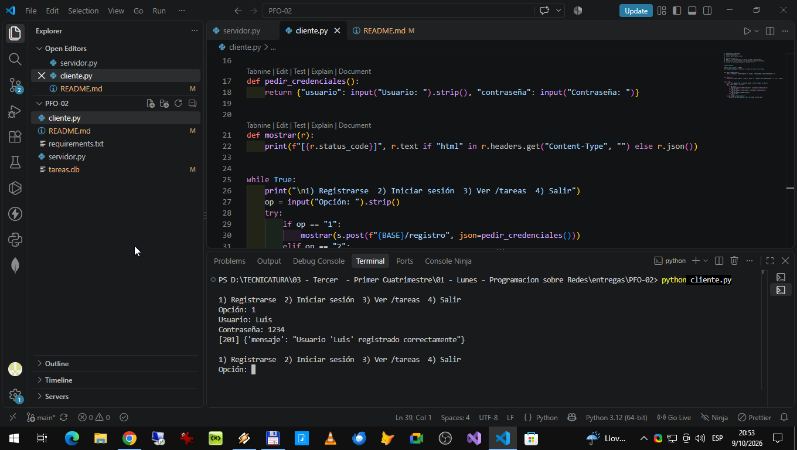
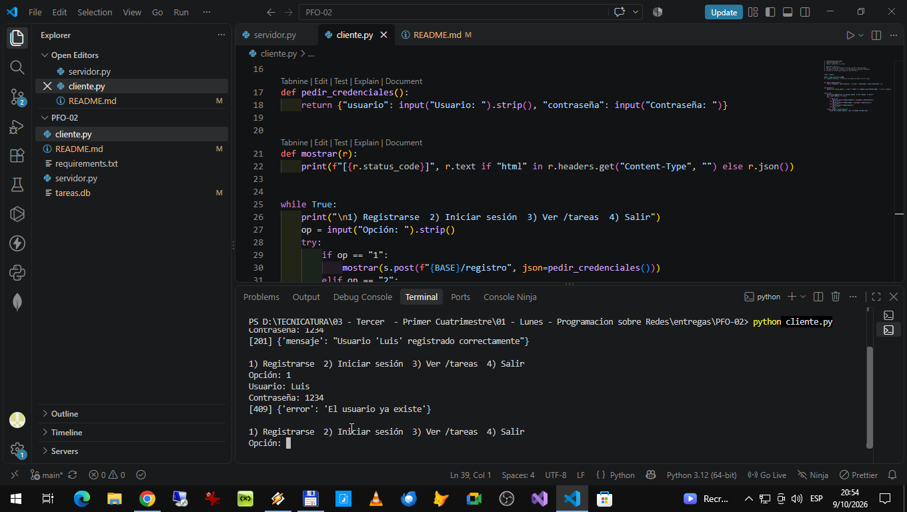
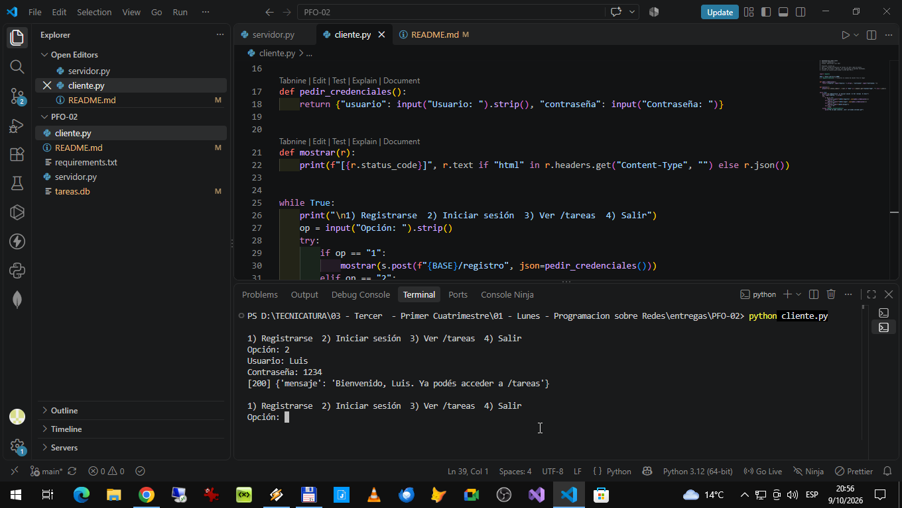
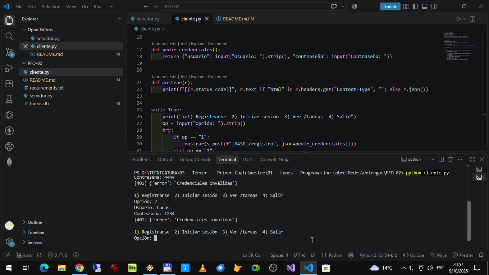
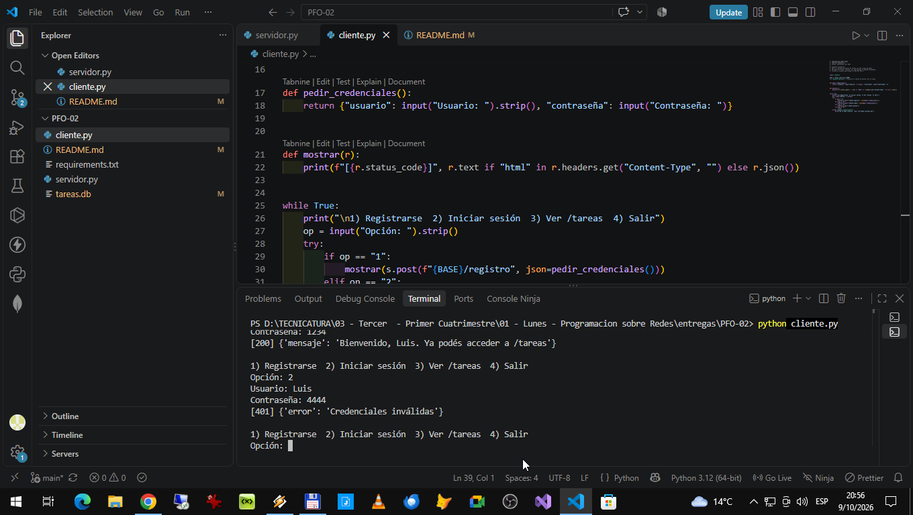
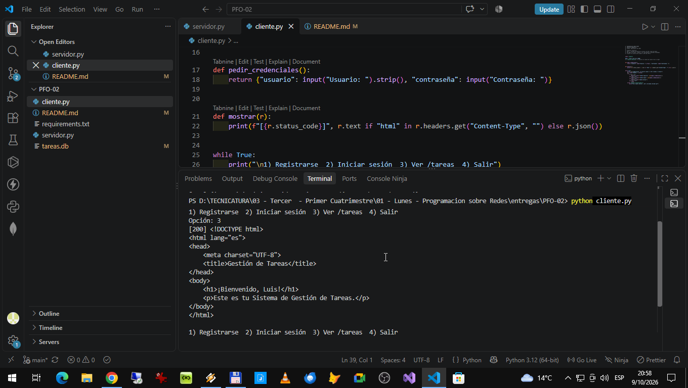

# PFO 2 – Sistema de Gestión de Tareas con API y Base de Datos

## PROGRAMACION SOBRE REDES

## Alumno    :  SPECTERMAN LUIS OMAR
## Comision  :  E

API REST hecha con **Flask** y **SQLite**. Los usuarios se registran con contraseña hasheada, inician sesión y acceden a una página de bienvenida en `/tareas`.

## Estructura

```
servidor.py        # API Flask + SQLite
cliente.py         # Cliente en consola (opcional)
requirements.txt
tareas.db          # se crea automáticamente al iniciar el servidor
```

## Cómo ejecutarlo

```bash
git clone <URL-DEL-REPOSITORIO>
cd <carpeta>
python -m venv venv
source venv/bin/activate        # Windows: venv\Scripts\activate
pip install -r requirements.txt
python servidor.py
```

El servidor queda en `http://127.0.0.1:5000`.

## Endpoints

| Método | Ruta        | Descripción                                             |
|--------|-------------|---------------------------------------------------------|
| POST   | `/registro` | Crea un usuario. Body: `{"usuario": "...", "contraseña": "..."}` |
| POST   | `/login`    | Verifica credenciales e inicia sesión (cookie)          |
| GET    | `/tareas`   | HTML de bienvenida. Requiere haber iniciado sesión      |

## Cómo probarlo

**Con el cliente de consola:** en otra terminal, `python cliente.py`.

Casos esperados: registro `201`, usuario repetido `409`, login correcto `200`, login incorrecto `401`, `/tareas` sin sesión `401` y con sesión `200`.

## Capturas de pantalla


## Registro Usuario Valido


## Intento Registro Usuario Existente


## Ingreso con Usuario Correcto


## Intento Ingreso con Usuario Invalido


## Intento Ingreso con Contraseña Incorrecta


## Ver Tareas



## Respuestas conceptuales

**¿Por qué hashear contraseñas?**

Porque si la base de datos se filtra, las contraseñas guardadas en texto plano quedarían expuestas. Además, muchas personas reutilizan sus contraseñas en distintos sitios, por lo que el problema podría afectar a otras cuentas.

El hash es una transformación que permite comprobar una contraseña sin guardar la original. Durante el inicio de sesión, el sistema verifica la contraseña ingresada utilizando el hash almacenado.

Los algoritmos seguros, como **scrypt, bcrypt y Argon2**, utilizan una **salt aleatoria**, que es un dato diferente para cada contraseña y permite que dos usuarios con la misma clave tengan hashes distintos. Además, estos algoritmos requieren tiempo y recursos para dificultar los ataques de fuerza bruta.


**Ventajas de usar SQLite en este proyecto**
- No requiere instalar ni configurar un servidor de base de datos: es un único archivo (`tareas.db`).
- Viene incluida en Python (módulo `sqlite3`), sin dependencias extra.
- Persiste los datos entre reinicios del servidor, a diferencia de guardarlos en memoria.
- Es liviana y portable, ideal para un proyecto académico o un prototipo.
